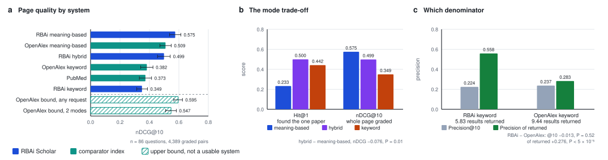
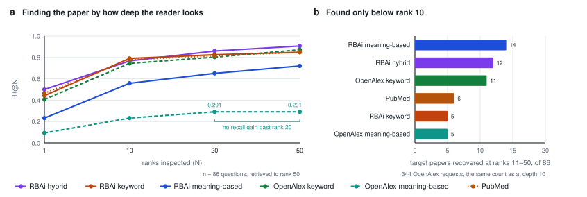

# The RBAi Scholar benchmark

Everything needed to recompute the published retrieval figures, without abstract text. Run
`node benchmark/score.mjs` (Node.js 18+, no install): it recomputes every figure from `data/` and checks it
against `results/`. Systems compared: RBAi Scholar (meaning-based, keyword and hybrid), OpenAlex (meaning-based
and keyword) and PubMed.

## Which corpus was tested

Every result here describes the 14 October 2026 version of the RBAi Scholar corpus: 11,257,530 records, of
which 11,149,057 can be returned by a search. A paper describing the benchmark is in preparation; until it
appears, each result file records when it was measured.

The live service has added papers since this version (24.6 million records on 16 November 2026), so a search
sent today can return a different list from the saved one. That does not change any number here: `score.mjs` reads only the saved files in `data/`, needs no
network, and never contacts the service. The DOI and PubMed ID of every record in the tested version (eight
gzip tables, with a flag for the records a search can return) will be attached to the v1.0.0 release and
archived at Zenodo with it, so the tested corpus can be rebuilt. Measurements on later versions will be added
as new, dated files, never in place of these. The released questions re-sent on 16 November 2026, at 24.6 million
records, are `data/live-24m-2026-11-16.jsonl.gz` and `results/live-24m-2026-11-16.json`.

## Development and held-out targets

The 500 known-item targets are 120 development targets, on which every design experiment was run
(`ablation-prefix-depth`, `identifier-86`, `fusion-identifier-86`, `marked-term-quality`, `placement-86`), and
380 held-out targets, drawn after the configuration was fixed and used only to measure it (field `half` of
`known-item-500.jsonl`: `published_120` and `new_380`). Meaning-based search finds 67.6% of the held-out targets
in the top 10 (257 of 380), against 56.7% of the development targets. The graded study, the identifier queries
and the choice-of-term comparison use the 86 development targets that contain an identifier; the 332 questions
with a required term are held-out targets; RELISH is independent of both.

## Which search index was tested

Every published number was measured on the reference implementation, PostgreSQL with an HNSW index (87.4 GB in
memory). Every published search was then sent again, unchanged, to two cheaper implementations: a disk-resident
DiskANN index (5.0 GB) and the edge deployment that serves the public service (Cloudflare Vectorize with D1, no
database server). The quoted-term sets were re-measured on the public service. The results agree:

| Measure | Reference (HNSW) | DiskANN | Edge deployment |
|---|---:|---:|---:|
| 500 reworded questions, meaning-based Hit@10 | 0.650 | 0.652 | 0.660 |
| 86 graded questions, meaning-based nDCG@10 | 0.575 | 0.577 | 0.573 |
| 86 identifier queries, keyword Hit@10 | 0.791 | 0.791 | 0.826 |
| 332 questions with a required term, hybrid Hit@10 | 0.928 | 0.928 | 0.943 (public service) |
| 86 identifier queries, rarest term quoted, Hit@10 | 0.709 | 0.709 | 0.709 (public service) |
| 86 identifier queries without quotation marks, meaning-based Hit@10 | 0.349 | 0.395 | 0.267 |

The one sensitive case is short identifier queries sent to meaning-based search without quotation marks: on the
edge deployment 7 of the 86 targets left the top 10 and none entered it. Quoting the identifier, or keyword
mode, removes the dependence. The reference value for quoted identifiers, 0.709 (61 of 86), scores the two
quoted terms present in more than 20,000 records as declined, as the reference service does
(`marked_term_df` in `marked-term-quality.jsonl`); the public service answers such terms. For the
public-service lists, papers added after the 14 October version were removed before scoring. Every request of
these re-runs is released (`data/rerun-*.jsonl.gz`, `data/hybrid-332-live.jsonl`,
`data/quoted-live-2026-11-14.jsonl`); `score.mjs` checks that these files are unchanged but cannot send the
requests again.

## Results

Measured against OpenAlex and PubMed on the same questions. Every number in these tables is recomputed from
the files in [`data`](data) by `node benchmark/score.mjs`, which also checks each one
against the published results (exactly, to four decimal places).

### Graded relevance: are the ten results worth reading?

86 research questions, each written by a language model (Claude Opus 5) from one paper's title and abstract
while avoiding its distinctive wording; measured afterwards,
the longest phrase a question shares with its paper's abstract is two words or fewer for 74 of them and three to
five words for 12. The top 10 from every system were pooled, and each of the 4,389 question–paper pairs was
graded 0–3 by a blinded language-model judge (Claude Opus 5 (Anthropic) at maximum thinking effort) that saw only the question, the title and the abstract
([protocol](JUDGING-PROTOCOL.md)).

| System | Hit@1 | MRR@10 | P@10 | nDCG@10 |
|---|---:|---:|---:|---:|
| RBAi Scholar, meaning-based | 0.233 | 0.334 | **0.513** | **0.575** |
| RBAi Scholar, hybrid | **0.500** | **0.592** | 0.348 | 0.499 |
| RBAi Scholar, keyword | 0.442 | 0.541 | 0.224 | 0.349 |
| OpenAlex, meaning-based | 0.093 | 0.130 | 0.481 | 0.509 |
| OpenAlex, keyword | 0.407 | 0.552 | 0.237 | 0.382 |
| PubMed | 0.477 | 0.579 | 0.235 | 0.373 |

Hit@1 and MRR@10 ask whether the paper the question was written from came back, and how high. P@10 is the
share of the ten results graded relevant (2 or 3); nDCG@10 also rewards how relevant they are and how high
they sit.

**A correction.** In 49 of the 688 ranked lists one paper appears twice in the top 10, mostly as two records of
the same paper, and the published scoring counted it twice. Counting each paper once lowers nDCG@10 and P@10 by
at most 0.01, and no system changes position. The table shows the corrected values; `score.mjs` recomputes them from the released rankings and grades and checks them against
`results/graded-relevance-v2.json`. The values as first computed stay in `results/graded-relevance.json`, and
`graded-relevance-corrections.json` lists every change. Hit@1, Hit@10 and MRR are not affected. One unadjusted
p-value crosses 0.05: on nDCG@10, OpenAlex keyword search is ahead of RBAi keyword search with p = 0.074 before
the correction and 0.041 after.

- Meaning-based search returns the most relevant pages. Against OpenAlex's meaning-based search, nDCG@10 is
  higher by 0.066 (paired permutation test, p = 0.005) and the source paper is in the top 10 for 33 questions
  where OpenAlex misses it, against 5 the other way. Against OpenAlex's stronger variant (question and
  keywords sent together) the nDCG@10 gain of 0.033 is not significant (p = 0.19).
- Hybrid search puts the exact paper first most often, at the cost of fewer relevant papers around it.
- Keyword mode is level with PubMed on Hit@10, P@10 and nDCG@10 (no significant difference). Both return fewer
  than ten papers for many questions (5.8 and 6.7 on average); of what they do return, keyword mode's share of
  relevant papers is higher, 0.559 against 0.510 (p = 0.022).

**A second judging round.** On 17 November 2026 the whole pool was graded again in one blinded round, 5,752 pairs
with the papers of OpenAlex's lists fetched again that day, by Claude Haiku 5.5 under the same rubric
(`round2-2026-11-17`). Meaning-based search again gave the most relevant
page, nDCG@10 0.651 against 0.592 for OpenAlex's meaning-based search on its new lists, and hybrid search again put
the source paper first most often. Against OpenAlex's new keyword lists, keyword mode's page scored lower, 0.384
against 0.449. The second round graded every system more leniently, so compare values within a round, not across
rounds.



### Retrieval depth: is the source paper anywhere in the top N?

| System | Hit@10 | Hit@20 | Hit@50 |
|---|---:|---:|---:|
| RBAi Scholar, hybrid | 0.767 | **0.861** | **0.907** |
| RBAi Scholar, keyword | **0.791** | 0.826 | 0.849 |
| RBAi Scholar, meaning-based | 0.558 | 0.651 | 0.721 |
| OpenAlex, keyword | 0.744 | 0.802 | 0.872 |
| OpenAlex, meaning-based | 0.233 | 0.291 | 0.291 |
| PubMed | 0.779 | 0.814 | 0.849 |

OpenAlex's meaning-based search finds nothing new after rank 20; RBAi Scholar keeps finding source papers down
to rank 50. Two hybrid searches were declined as too broad and count as misses, so 0.907 is a floor.



### Known-item retrieval: two query sets for the same 120 papers (Hit@10)

The 120 development targets, 24 from each of five citation bands (0–9 citations up to 1,000 or more), searched
with two separate query sets: questions worded unlike the paper, and passages copied from its abstract. RBAi
Scholar ran here in its development configuration, before the task instruction and the 200-candidate pool; in
the evaluated configuration it finds 56.7% of the same papers from the questions (`known-item-500`). Copied text
at least doubles every system's score, which is why the main test uses reworded questions.

| Query | RBAi Scholar | OpenAlex | PubMed |
|---|---:|---:|---:|
| A question in the researcher's own words (120) | **44.2%** | 26.7% | 1.7% |
| The first 350 characters of the abstract (120) | **89.2%** | 54.2% | 23.3% |

For questions in the researcher's own words, RBAi Scholar found 33 papers OpenAlex missed and OpenAlex 12 that
RBAi Scholar missed (exact McNemar test, Holm-corrected p = 0.002). PubMed matches the words typed, so a
question worded differently from the paper rarely finds it.

### Short identifier queries: why keyword mode exists

86 short queries built around one identifier, a gene symbol, compound or acronym (for example
`TMF well-stirred model`). The table is the development comparison of the first versions of the two modes
(`identifier-86`): meaning-based matching by similarity alone, keyword matching by PostgreSQL's `ts_rank_cd`.

| Mode | Hit@1 | Hit@10 | Papers found only by this mode |
|---|---:|---:|---:|
| Keyword | **41.9%** | **70.9%** | **49** |
| Meaning-based | 7.0% | 17.4% | 3 |

In the configuration used for the evaluation the same 86 queries reach Hit@10 79.1% in keyword mode (the
graded study's keyword runs, `runs-top10`), 34.9% in meaning-based mode without quotation marks and 70.9% with
the query's rarest word quoted, which is the identifier in 78 of the 86 (`marked-term-quality`; the two quoted
terms present in more than 20,000 records count as declined). Paired on those runs, 39 targets are found only by
keyword search, 1 only by meaning-based search and 29 by both.

The ordering reverses between the two kinds of query, which is why the service keeps both indexes and the
MCP server offers both tools.

### Other experiments

The other experiments are released the same way, per question and without abstract text. The values
below are read from `results/figures`, which `score.mjs` rebuilds from the released files. Most are
recomputed from the per-question records; the prefix, ranking-term and RELISH rows repeat the published
summaries (the `ci_method` field of each figure file says which).

| Experiment | Records (`benchmark/data`) | Result |
|---|---|---|
| Known-item retrieval, 500 questions, ranks to 50 | `known-item-500` | Hit@10: RBAi meaning-based 0.650, OpenAlex meaning-based 0.278, PubMed 0.008 |
| LitSense 2.0, the same 500 questions | `litsense-500`, `litsense-harness-control` | Hit@10 0.650 against 0.186; MRR@50 0.4431 against 0.0945 |
| 332 questions with one term marked as required (the 332 of the 380 added targets that had a qualifying term) | `hybrid-332` | RBAi hybrid: Hit@10 0.928, Hit@50 0.967 |
| LitSense 2.0 on those questions (328 answered by both) | `litsense-hybrid-332` | Hit@10: LitSense 0.213, or 0.421 with the term added; RBAi meaning-based 0.671, hybrid 0.939 |
| MedCPT re-ranking our candidate lists, 500 questions | `medcpt-500`, `medcpt-round2` | MRR@50: our ranking 0.443; MedCPT bi-encoder 0.371; MedCPT cross-encoder 0.587 |
| RELISH, 1,209 seed articles | `relish` | nDCG@10: our ranking 0.8431, similarity alone 0.8387; MedCPT article encoder 0.7958, cross-encoder 0.8225 |
| Query instruction prefix, 120 development questions | `ablation-prefix-depth` | Hit@10 0.442 without the prefix, 0.583 with it |
| Each ranking term left out, 120 questions | `priors-ablation` | Hit@10 0.567 with every term, 0.525 on similarity alone |
| A marked term on two kinds of query: the query's rarest word quoted (development targets) | `marked-term-quality` | identifier queries (the identifier quoted in 78 of 86): Hit@10 0.349 → 0.721 as first measured, 0.709 with terms in more than 20,000 records declined; fluent questions: 0.568 → 0.237, or 0.161 with that limit |
| Which term to mark, 86 questions | `hybrid-86-paired` | Hit@10 0.872 with the term chosen for relevance, 0.767 chosen for rarity (McNemar p = 0.035) |
| Where the marked term sits in the question | `placement-86`, `hybrid-handplaced` | Hit@10 from 0.744 to 0.767 across placements |
| BM25, ts_rank and meaning-based search on identifier queries (development experiment) | `fusion-identifier-86` | Hit@10: BM25 0.756, ts_rank 0.709, meaning-based by similarity alone 0.174 |
| HNSW `ef_search`, 20 queries (a development setting) | `efsearch-tuning` | Hit@10 0.95 at every setting; median search 5.1 s at 2.0×, 3.9 s at 1.2× |
| Are the 500 target papers in OpenAlex and PubMed? | `coverage-120`, `coverage-500` | all 500 in OpenAlex, 499 in PubMed |
| The 332 hybrid questions on the public service (edge deployment) | `hybrid-332-live` | Hit@10 0.940, Hit@50 0.976 (reference 0.928, 0.967) |
| The quoted-term sets on the public service, exact quoted-term ranking (papers added after the 14 Oct version removed) | `quoted-live-2026-11-14` | Hit@10: 332 held-out hybrid questions 0.943 (reference 0.928), identifier queries 0.709 (0.709), graded-study hybrid 0.802 (0.767), relevance-selected terms 0.895 (0.872), fluent questions 0.263 (0.161) |
| How much of PubMed is in RBAi Scholar: 200 random PubMed papers with an abstract, 2000–2025 | `coverage-sample-200`, `coverage-spotcheck-2026-11-12` | 43 of 200 present (21.5%; 95% CI 16.4–27.7%), on the 14 October 2026 version |
| The released questions on the live service at 24.6 million records, 16 Nov 2026 | `live-24m-2026-11-16` | Hit@10: 500 reworded questions, meaning-based 0.638 (reference 0.650), 380 held-out 0.666 (0.676), 328 with a required term, hybrid 0.933 (0.939), identifier queries, keyword 0.779 (0.791); Hit@1 of the 500: 0.304 (0.328) |
| OpenAlex meaning-based search asked the 500 questions again on 17 Nov 2026, after it moved to Qwen3-Embedding-0.6B | `openalex-500-2026-11-17` | Hit@10 0.458 (September 0.278), 380 held-out 0.482; RBAi meaning-based 0.650 |

On the 500 questions, MedCPT's cross-encoder orders our candidates better than our own ranker does; on RELISH
our ranking is ahead of both MedCPT models.
RELISH's relevance labels are not copied here: `relish.jsonl` holds our per-seed scores, and the labels are on
figshare ([RELISH_v1](https://doi.org/10.6084/m9.figshare.7722905.v1), CC0). Latencies are
released as recorded values only, since they cannot be recomputed offline.
The tables under Files below list every file.

## Reproduce the figures

```bash
git clone https://github.com/Insightwithhari/rbai-scholar.git
cd rbai-scholar
node benchmark/score.mjs        # Node.js 18 or newer; nothing to install
```

It prints the tables above, recomputes every value from the released data, checks it against the published
results in `results/` and reports any difference (it does not read this README). The
statistics are the analysis scripts' own, with the same seeds, so the bootstrap intervals and p-values in
`results` are reproduced exactly too. The Files section below describes every
file and field.

## What the release leaves out

- **No abstract text.** The retrieval logs behind the benchmark carry each paper's abstract, which belongs to
  its publisher or author. This release has identifiers (DOI, PubMed id), titles, years and journals instead.
  The 120 queries that are the first 350 characters of an abstract are withheld for the same reason; their
  rankings are included. In 26 of the judge's 4,465 reasons, a quoted run of 10 or more words from an abstract
  is replaced by `[…]`; the grades are unchanged.
- **The 76 supplemental grades** (`judgements-supplemental.jsonl`) belong to the hybrid sensitivity analysis
  that places the identifier beside the concept it qualifies (placements made by the language model;
  `handplaced-graded-relevance.jsonl`).
- **Offline recomputation, not a re-run.** The scorer recomputes the reported metrics from the released
  rankings and grades. It does not rebuild the corpus, re-run the searches or re-judge the papers.

## Files

| File | Rows | What it holds |
|---|---:|---|
| `data/questions.json` | 86 | the graded questions in scoring order, every query variant sent, and the paper each was written from |
| `data/runs-top10.jsonl` | 688 | for each question and system: status, the query as sent, the source paper's rank, and the top 10 as paper keys |
| `data/judgements.jsonl` | 4,389 | every pooled question–paper pair: grade 0–3, the judge's reason, which systems returned it and where |
| `data/judgements-supplemental.jsonl` | 76 | grades for the hybrid sensitivity analysis that places the identifier beside the concept it qualifies (`handplaced-graded-relevance.jsonl`) |
| `data/depth50.jsonl` | 688 | for each question and system: status, results returned and the source paper's rank in the top 50 |
| `data/known-item-240.jsonl` | 240 | the known-item benchmark: query, overlap with the abstract, target paper, each system's rank |
| `data/identifier-86.jsonl` | 86 | short identifier queries: the query, its anchor term, and the rank in each mode |
| `results/graded-relevance.json` | | published graded results: metrics, 95% bootstrap intervals, paired tests, per-question values |
| `results/depth50-summary.json` | | published depth results |
| `results/known-item-240.json` | | published known-item results, with Holm-corrected tests |
| `results/identifier-86.json` | | published identifier-query results |
| `results/graded-relevance-v2.json` | | graded relevance with each paper counted once per ranked list, Holm-adjusted p-values, and a title-only sensitivity analysis |
| `results/graded-relevance-corrections.json` | | every value the correction changed, old and new |
| `MANIFEST.json` | | SHA-256 of every file, the source commit, row counts, and the reasons whose quotes were removed |

### Other experiments

Each has its records in `data/<name>.jsonl` and the published summary in `results/<name>.json`; the values a
figure would plot, with 95% intervals, are in `results/figures/`.

| Name | What it is |
|---|---|
| `known-item-500` | 500 questions (the 120 above and 380 more, 100 per citation band); target rank to 50 for RBAi, OpenAlex and PubMed |
| `coverage-120`, `coverage-500` | whether each target is in OpenAlex and PubMed, and the informed PubMed query |
| `litsense-500`, `litsense-harness-control` | LitSense 2.0 on the 500 questions, and a check of our LitSense client |
| `hybrid-332` | 332 of the 380 added targets, those with a qualifying term (chosen for relevance and placed in the question by the language model that wrote the questions) marked as required; RBAi hybrid search. None of the 120 original targets is among them |
| `litsense-hybrid-332` | LitSense 2.0 on those questions, with and without the marked term |
| `medcpt-500`, `medcpt-round2` | MedCPT bi-encoder and cross-encoder re-ranking our candidate lists |
| `relish` | RELISH (1,209 seed articles): per-seed scores for our ranking and MedCPT. The labels are not copied; they are on figshare ([RELISH_v1](https://doi.org/10.6084/m9.figshare.7722905.v1), CC0) |
| `ablation-prefix-depth` | the query instruction prefix and candidate depth, 120 questions |
| `priors-ablation` | each ranking term left out in turn |
| `hybrid-86-paired`, `placement-86`, `hybrid-handplaced`, `handplaced-graded-relevance` | which term to mark, and where it sits in the question |
| `marked-term-quality`, `fusion-identifier-86` | a marked term, BM25, ts_rank and rank fusion on identifier queries and fluent questions |
| `known-item-216-first-attempt` | the 240 known-item queries restricted to the 216 that every system answered at the first attempt |
| `depth50-hybrid-rerun` | the depth-50 hybrid run repeated under the deployed statement timeout |
| `efsearch-tuning` | the HNSW `ef_search` sweep |
| `rerun-diskann`, `rerun-diskann-postfix`, `rerun-vectorize`, `rerun-vectorize-postfix`, `rerun-cloudflare` | the published searches re-issued on the disk-resident DiskANN index and the edge deployment, 13–14 Oct 2026: `data/rerun-*.jsonl.gz` has one line per request (route, status, latency, ranked identifiers and titles), `data/rerun-grades.jsonl` the 119 newly returned papers graded afterwards, `results/rerun-*.json` the analyses. Recorded on the live service; `score.mjs` checks the files are unchanged but does not recompute them |
| `hybrid-332-live` | the 332 hybrid questions sent again to the live service on 12 Nov 2026: per question, the status, time, which index answered and the target's rank (identifiers and ranks only) |
| `quoted-live-2026-11-14` | every quoted-term set (86 identifier queries, 118 fluent questions, 86 graded-study hybrid queries, 86 relevance-selected terms, 332 held-out hybrid questions) sent to the public service on 14 Nov 2026, which ranks quoted terms exactly: per search, the status, route, published rank and ranked identifiers, each flagged by membership of the 14 October version (identifiers and ranks only). Recorded on the live service; `score.mjs` checks the files are unchanged |
| `live-24m-2026-11-16` | the released questions re-sent unchanged, at their published depths, to the public service on 16 Nov 2026, at 24,610,186 records: the 500 reworded questions, the 86 graded-study questions in the three modes, the 332 held-out hybrid questions and the quoted-term sets, 1,756 searches. `data/live-24m-2026-11-16.jsonl.gz` has one line per search (status, timings, the DOIs and PubMed IDs returned, the target's rank; identifiers and ranks only), `results/live-24m-2026-11-16.json` the summary, with paired comparisons against the reference and the October edge run. Recorded on the live service; `score.mjs` checks the files are unchanged |
| `openalex-500-2026-11-17` | the 500 reworded questions sent again to OpenAlex semantic search on 17 Nov 2026, after OpenAlex documented its switch to Qwen3-Embedding-0.6B, through the code of the September run: per question the attempt that was answered, the target's rank (and its September rank), and the returned identifiers, titles, years and relevance scores; `results/openalex-500-2026-11-17.json` the scored summary. Recorded on OpenAlex; `score.mjs` checks the files are unchanged |
| `round2-2026-11-17` | the graded study judged again in one round (round 2, 17 Nov 2026): all 5,752 pairs of every configuration in the graded-relevance table, the September lists and OpenAlex's lists re-queried on 17 Nov 2026, graded blind by Claude Haiku 5.5 (three batches graded again by an independent session, the pre-registered test-retest check): `data/round2-2026-11-17.jsonl.gz` has the re-queried lists, every round-2 grade with its reason (by question and paper, no abstract text) and the retest grades; `results/round2-graded-2026-11-17.json` the scored summary. `score.mjs` checks the files are unchanged |
| `coverage-sample-200`, `coverage-spotcheck-2026-11-12` | 200 PubMed papers drawn at random (abstract, 2000–2025, seed 20261112), each looked up in RBAi Scholar by PubMed ID and then DOI on 12 Nov 2026; and three landmark papers checked by PubMed ID |

Released as recorded values only, because they cannot be recomputed offline: `corpus-stats`,
`quoted-term-ceiling`, `openalex-rank20` and `ranking-weight-sensitivity`.

## Keys and fields

A paper is identified by `doc_key`: `doi:<doi>` when it has a DOI, otherwise `pmid:<id>`, otherwise a
normalised title. In `runs-top10.jsonl` each returned paper was resolved to the judged pool's `doc_key` with the
pool's own alias table, which merges a paper that two services report with different identifiers. Two returned
records carried no identifier at all and have `doc_key: null`; they score as not relevant, as in the published
analysis.

`system` names: `rbai_semantic`, `rbai_keyword`, `rbai_hybrid`, `openalex_semantic`, `openalex_keyword`,
`openalex_combined_semantic` and `openalex_combined_keyword` (question and keyword query sent together), and
`pubmed_keyword`. `status` is `ok`, `declined` (refused as too broad) or `error`; a declined or failed search
counts as returning nothing.

Grades: 3 directly answers the question; 2 substantially relevant; 1 marginally relevant; 0 not relevant.
Relevant means 2 or 3. `judged_on_title_only` marks the 589 papers for which no abstract was available.

## How it was built

1. **Targets.** Papers sampled from the corpus evenly across five citation bands (0–9, 10–49, 50–199, 200–999,
   1,000 or more), so lightly cited work, half the corpus, is properly represented.
2. **Questions.** For each target, a question a researcher might ask, sharing no phrase longer than two words
   with the paper, plus a short keyword query for the same need.
3. **Runs.** Each question sent to every system; the top 10 kept for grading and the top 50 for depth.
4. **Pool and grades.** The union of every system's top 10 and the source paper, deduplicated, graded 0–3 by
   blinded judges that saw only the question, title and abstract, with a written reason for each grade
   ([JUDGING-PROTOCOL.md](JUDGING-PROTOCOL.md)). The source paper was graded relevant in at least 80% of
   questions, the check on the judge.
5. **Scoring.** nDCG@10 with gain 2^grade − 1 and discount 1/log2(rank + 1), normalised by the best ranking the
   judged pool allows; bootstrap intervals over questions (10,000 resamples, seed 20260908); exact McNemar tests
   for Hit@10 and paired permutation tests (20,000) for continuous measures.

## Limitations

- **Pooling.** Only papers some system returned were judged. A relevant paper no system found never enters the
  ideal ranking, so nDCG is measured against the best of what was found. The bias applies to every system.
- **One judge per pair.** Grades come from blinded language-model judges, one per pair, so there is no human
  inter-assessor agreement figure. The reasons are released so that any grade can be checked and disputed.
- **Withheld text.** 26 of the 4,465 reasons quoted ten or more consecutive words of an abstract; those runs are
  replaced by `[…]` (listed in `MANIFEST.json`). The 120 verbatim-control queries of the known-item benchmark
  are the first 350 characters of the target's abstract and are withheld; their rankings are included.
- **The oracles are not systems.** `openalex_best_of_both` and `openalex_oracle_any` in the graded results take,
  per question, whichever OpenAlex request did best, which needs the answer in advance. They are upper bounds.
- **Third-party indexes change.** OpenAlex and PubMed were queried in September 2026, and OpenAlex again on
  17 November 2026 (`openalex-500-2026-11-17`, `round2-2026-11-17`); re-running them today can give different
  results. The released runs are what was measured.
